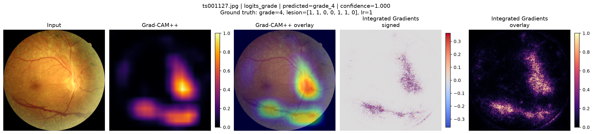

# Clinically Explainable AI for Diabetic Retinopathy Grading (MMRDR-CFP)

> **Disclaimer:** This repository contains a **research prototype** developed for academic assessment purposes. It is **not** a clinically validated diagnostic tool and must not be used for clinical decision-making or patient care without independent clinical validation and regulatory approval.

## 1. Project Overview
Diabetic retinopathy (DR) is a leading cause of preventable vision loss. While deep learning models can assist in automated screening from colour fundus photography (CFP), clinical adoption requires transparent visual explanations, calibrated confidence estimates, and safe triage mechanisms for uncertain cases.

This project implements an end-to-end, reproducible, and explainable deep learning pipeline for **5-class DR severity grading** using the **Multi-Modal Retinal Images for In-depth DR Analysis (MMRDR)** dataset:
* **Grade 0:** No DR
* **Grade 1:** Mild non-proliferative DR (NPDR)
* **Grade 2:** Moderate NPDR
* **Grade 3:** Severe NPDR
* **Grade 4:** Proliferative DR (PDR)

### Key Features
* **Automated Optical Circle Cleaning & ROI Cropping:** Adaptive corner-floor + Otsu thresholding with 360° polar angular binning and Wide-Arc RANSAC circle fitting (`process_DarkCornerPad.py`) to remove outer-circle border artefacts/notches, paired with dynamic dark-border ROI cropping (`crop_fundus_roi`).
* **Leakage-Free Stratified Splitting:** Preserves the official benchmark test partition (`ts*` images locked) and splits predefined training images (`tr*`) into 85% training and 15% validation sets stratified by DR grade (`SEED = 77`).
* **Imbalance-Aware ResNet-50 Architecture:** Pretrained `ResNet50_Weights.IMAGENET1K_V2` backbone trained at `512×512` resolution with square-root inverse class-frequency weighted Cross-Entropy loss, Cosine Annealing learning rate schedule, mixed-precision (`AMP`), and Early Stopping.
* **Clinical Reliability & Selective Triage:** Post-hoc **Temperature Scaling** fitted on the validation set to minimise Expected Calibration Error (ECE), **Predictive Entropy** thresholding (80th validation percentile) for clinician referral simulation, and **Image Quality Degradation Sensitivity** testing under synthetic blur and illumination drop.
* **Visual Explainability (XAI):** Dual post-hoc attribution maps using **Grad-CAM++** (regional feature localisation at `layer4[-1]`) and **Integrated Gradients** (fine-grained pixel-level signed and magnitude attributions).

---

## 2. Repository Structure

```text
.
├── EDA.ipynb                     # Step 1: Exploratory data analysis of grades, laterality, and lesions
├── process_DarkCornerPad.py      # Step 2: RANSAC optical circle detection and outer-artefact masking
├── prepare_splits.py             # Step 3: Stratified train/val split of 'tr*' and locking of 'ts*' test set
├── train_hyperTuning.py          # Step 4: Greedy / Grid hyperparameter search logged to TensorBoard
├── train_model.py                # Step 5: Main ResNet-50 model training pipeline with Early Stopping
├── evaluate_model.py             # Step 6: Locked test set evaluation, calibration, triage & robustness
├── explain_one_image.py          # Step 7: Grad-CAM++ and Integrated Gradients explanation generator
├── requirements.txt              # Python package dependencies
└── README.md                     # Project documentation and reproducibility guide
```

## 3. Environment Setup
To create an environment on Anaconda, please refer to below:
```text
# Clone the repository
git clone https://github.com/ChuinHongYap/DR_Analysis_CFP.git
cd DR_Analysis_CFP

# Create and activate a virtual or conda environment
conda create -n dr_cfp python=3.11 -y
conda activate dr_cfp

# Install dependencies
pip install -r requirements.txt
```

## 4. Example Outputs
Explainability output


